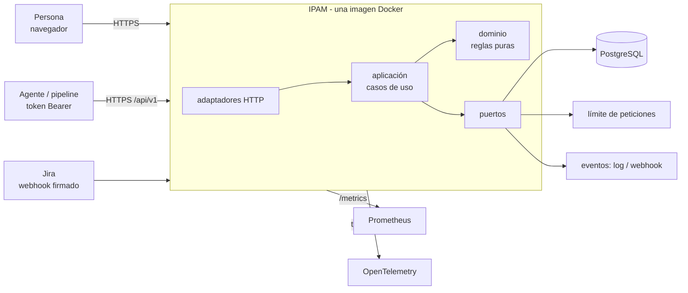
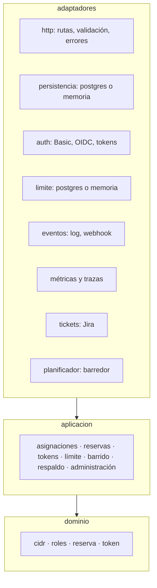
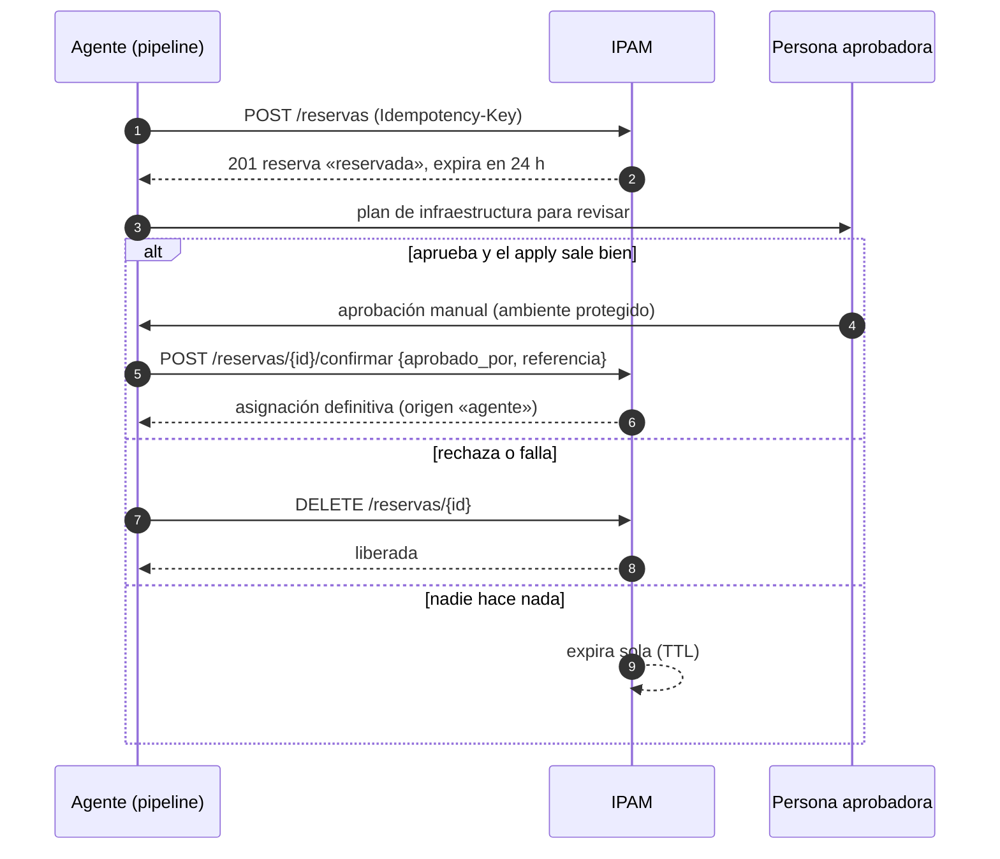
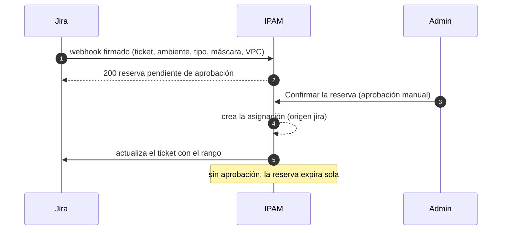
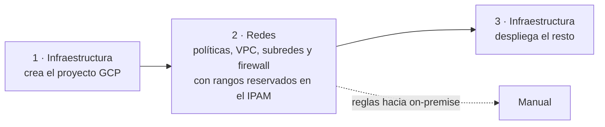

# Arquitectura

## 1 · Vista general
El IPAM es un servicio web (Node 22 + Express 5) con PostgreSQL 16 como única dependencia obligatoria. Se entrega como **imagen Docker más variables de entorno**; no usa SDK ni servicios propios de ningún proveedor ([PORTABILIDAD](PORTABILIDAD.md), [ADR 0008](adr/0008-portabilidad-entre-nubes.md)).

## 2 · Capas (hexagonal)

- `mvp/src/dominio/`: reglas **puras** (sin base de datos ni red): cálculo de CIDR, roles, ciclo de vida de reservas.
- `mvp/src/aplicacion/`: casos de uso que dependen de **puertos** (interfaces), nunca de PostgreSQL directamente.
- `mvp/src/adaptadores/`: implementaciones concretas. Para PostgreSQL hay uno real y uno en memoria (para pruebas).
- `mvp/src/server.js` compone todo; `arranque.js` maneja el ciclo de vida y el apagado ordenado.
- Una guardia automática (`make portabilidad`) falla si el núcleo importa un SDK o nombra un proveedor. Para añadir una pieza nueva: [CONTRIBUIR](CONTRIBUIR.md).

## 3 · Garantías en la base de datos
La corrección no depende del código de la aplicación:
- **Sin solapamientos:** restricción de exclusión (GiST) por pool; dos segmentos que se cruzan no pueden coexistir, ni con concurrencia.
- **Reservas y asignaciones se respetan entre sí:** disparadores impiden asignar sobre una reserva vigente ajena y reservar sobre una asignación.
- **Reloj único:** el reloj autoritativo es el de la base de datos, no el de cada réplica.
- **Auditoría de solo inserción:** disparadores impiden `update`, `delete` y `truncate`.
- **Roles de mínimo privilegio:** `ipam_migrador` (dueño, aplica el esquema) e `ipam_app` (solo DML).

## 4 · Reservas tentativas y *human-in-the-loop*

**Tickets de Jira: el mismo principio.** El webhook **no asigna**: crea una reserva (solicitante `jira-webhook`, idempotente por ticket) y un **admin** la aprueba en la pestaña Reservas. Solo entonces se asigna el CIDR (origen `jira`) y se actualiza el ticket.

**Por qué así:** un agente puede equivocarse o ser engañado. Si pudiera asignar directo, un error consumiría rangos de forma permanente. Con la reserva, lo peor que pasa es que un rango queda apartado un día. Reglas:
- Un agente **nunca** asigna directo: solo reserva, confirma lo suyo y libera lo suyo.
- Confirmar exige `aprobado_por` y `referencia`; ambos van a la auditoría.
- Toda reserva sin confirmar **expira sola**; el barredor solo limpia, la expiración perezosa garantiza la corrección.
- El IPAM no puede comprobar la identidad de quien aprobó; la garantía es el **ambiente protegido** del pipeline ([LIMITACIONES](LIMITACIONES.md)). Más en [BUENAS-PRACTICAS](BUENAS-PRACTICAS.md).

## 5 · Orden de ejecución entre equipos (MVP del cliente)
El MVP: **asignar subredes a un proyecto GCP nuevo a partir de un YAML** ([CONTRATO-YAML-REDES](CONTRATO-YAML-REDES.md), propuesta pendiente de validar).

Pipeline de redes (OpenTofu): `validate → scan (Trivy y Checkov) → plan → aprobación manual → apply → confirmar-ipam`, con `liberar-ipam` si algo falla o se rechaza. Detalle y ejemplo en [ops/gitlab](ops/gitlab/README.md). Las redes críticas llevan `lifecycle { prevent_destroy = true }`.

## 6 · Procesos y escalado
- Sin estado en memoria: se pueden correr varias réplicas. El límite de peticiones y el barredor comparten estado en PostgreSQL (el barredor usa un *advisory lock*: solo una réplica lo ejecuta a la vez).
- `ROL=api|worker|todos` permite separar réplicas HTTP de la que barre.
- `/healthz` (vivo) y `/readyz` (listo: base alcanzable y versión de esquema mínima).
- Apagado ordenado con SIGTERM: termina las peticiones en curso (`APAGADO_TIMEOUT_MS`).
- La migración del esquema es un paso aparte (`npm run migrar`); la app no modifica el esquema al arrancar salvo `MIGRAR_AL_ARRANCAR=true`.

## 7 · Decisiones
[ADR 0000–0009](adr/): arquitectura desacoplada, reservas, tokens, TTL de 24 h, seguro por defecto, rate limiting, métricas, POC Render + Supabase, portabilidad entre nubes y CI portable.
