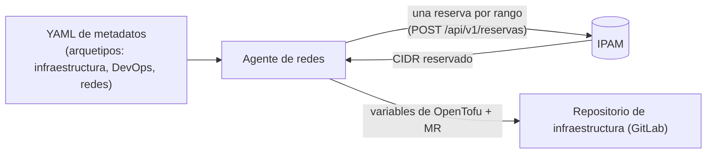
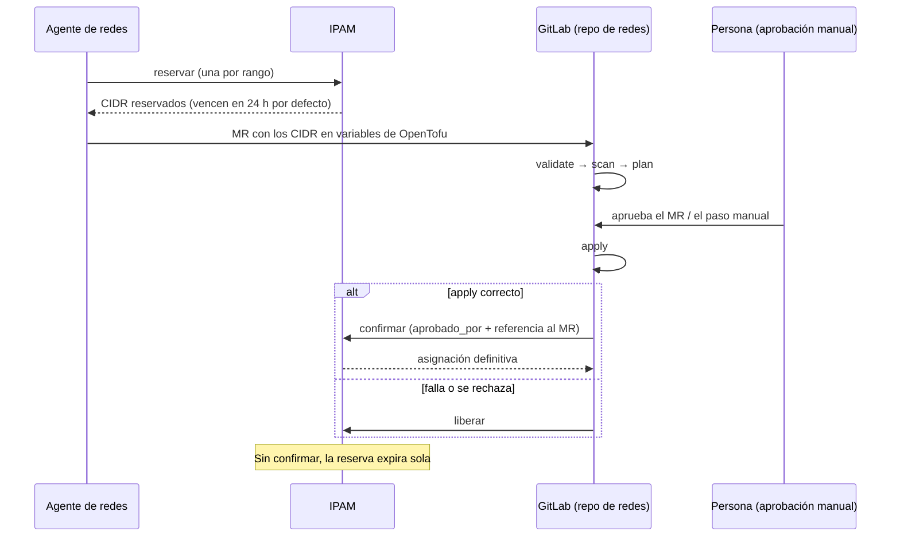

# Contrato YAML de redes (lo que el IPAM consume)

> ⚠️ **PROPUESTA PENDIENTE DE VALIDAR.** El contrato oficial entre agentes vive en el repo `cd-agents` (arquetipos de infraestructura,
> DevOps y redes), al que **no se tuvo acceso** al escribir esto. Aquí solo se propone el fragmento de **redes** que necesita el IPAM, sin
> inventar campos de los otros arquetipos. Antes de usarlo, alguien con acceso a `cd-agents` debe comparar nombres y estructura y ajustar este
> documento, el esquema ([`contrato/redes.schema.json`](contrato/redes.schema.json)) y los ejemplos si hay diferencias.

## Para qué sirve
El agente de redes recibe un YAML de metadatos de un **proyecto nuevo de GCP** y necesita asignarle rangos IP sin chocar con nadie.
Del YAML solo le importa a este servicio la sección `redes.ipam_reservations`: una lista de **subredes**, cada una con un rango principal
y, opcionalmente, rangos secundarios (en GKE: Pods y Servicios).

## El fragmento

| Campo | Obligatorio | Qué es | Valores |
|---|---|---|---|
| `redes.ipam_reservations[]` | sí | Lista de subredes a reservar | al menos una |
| `…subnet` | sí | Nombre lógico de la subred. Con el ambiente forma la clave de idempotencia | `^[a-z][a-z0-9-]{1,40}$` |
| `…region` | no | Región de GCP (informativa para el agente; el IPAM no la usa) | p. ej. `us-central1` |
| `…ambiente` | sí | Ambiente | `dev`, `qa`, `pre` o `prod` |
| `…ttl_horas` | no | Cuánto dura la reserva sin confirmar | 1 a 72 (por defecto 24) |
| `…primary.tipo` | sí | Tipo de pool del rango principal | `Nodos`, `Pods`, `Servicios`, `Control plane`… |
| `…primary.mascara` | sí | Tamaño del bloque (`24` = /24) | 8 a 32 |
| `…primary.pool` | no | Pool concreto, solo si hay más de uno del mismo ambiente y tipo | id del pool |
| `…secondary_ranges[].name` | sí | Nombre del rango secundario (en GKE, el nombre del rango de la subred) | `^[a-z][a-z0-9-]{1,40}$` |
| `…secondary_ranges[].tipo / mascara / pool` | sí / sí / no | Igual que `primary` | |

## Cómo lo traduce el agente a llamadas al IPAM
Una entrada de `ipam_reservations` con *n* rangos produce *n* reservas. La clave de idempotencia hace que **reintentar no duplique nada**.

| Rango del YAML | Llamada | `Idempotency-Key` |
|---|---|---|
| `primary` | `POST /api/v1/reservas` con `ambiente`, `tipo`, `mascara`, `vpc` (proyecto/VPC), `ticket`, `ttl_horas` | `<proyecto>:<ambiente>:<subnet>:primary` |
| `secondary_ranges[i]` | igual, con el `tipo` y `mascara` del rango | `<proyecto>:<ambiente>:<subnet>:<name>` |

- Si el IPAM responde **422 `ambiguo`** trae las `opciones` (pools candidatos): hay que indicar `pool` en el YAML.
- Si responde **409 `solapamiento`** trae `sugeridos`: el agente puede pedir otro rango.
- Si responde **429 `cuota_excedida`**: el token tiene demasiadas reservas vigentes; confirmar o liberar alguna.

## Qué pasa después (human-in-the-loop)
Una reserva **no es definitiva**: expira sola si nadie la confirma. Se vuelve asignación definitiva solo después de que **una persona aprueba**:

El pipeline de ejemplo con las etapas `validate → scan → plan → aprobación manual → apply → confirmar-ipam` (y `liberar-ipam` si algo falla)
está en [`ops/gitlab/`](ops/gitlab/).

## Ejemplos completos y válidos
Ambos se validan automáticamente contra el esquema en cada ejecución de pruebas (`src/contrato-yaml.test.js`).

1. [`ejemplos/redes-proyecto-nuevo-dev.yaml`](ejemplos/redes-proyecto-nuevo-dev.yaml): proyecto nuevo en dev con un clúster GKE.
2. [`ejemplos/redes-proyecto-todos-ambientes.yaml`](ejemplos/redes-proyecto-todos-ambientes.yaml): el mismo proyecto en dev, qa, pre y prod, con plano de control y subred de apoyo.

## Lo que este contrato NO hace
- No define la estructura del resto del YAML (infraestructura y DevOps): eso es de `cd-agents`.
- No cubre on-premise: la automatización es solo GCP y las reglas perimetrales hacia on-premise son manuales (ver [`LIMITACIONES.md`](LIMITACIONES.md)).
- No soporta IPv6 (solo IPv4).
