# Manual de usuario del IPAM

Guía paso a paso para quien usa el IPAM en su trabajo diario: pedir un rango de red, revisar cuánto espacio queda, registrar la IP de un equipo o aprobar una solicitud. No hace falta saber programar.

> **¿Buscas algo distinto?** Esta guía explica *cómo hacer las tareas*. Para el detalle de cada pantalla está el [Manual de uso](MANUAL-DE-USO.md); para instalar el sistema, [Despliegue](ops/DESPLIEGUE.md); para automatizar con pipelines, [API y agentes](API-Y-AGENTES.md). Las palabras técnicas están en el [Glosario](GLOSARIO.md).
>
> Los rangos de los ejemplos son **ficticios**.

## Contenido
1. [Qué es el IPAM y para qué sirve](#1-qué-es-el-ipam-y-para-qué-sirve)
2. [Las tres palabras que debes conocer](#2-las-tres-palabras-que-debes-conocer)
3. [Entrar y qué puedes hacer según tu rol](#3-entrar-y-qué-puedes-hacer-según-tu-rol)
4. [Recorrido por la pantalla](#4-recorrido-por-la-pantalla)
5. [Tareas paso a paso](#5-tareas-paso-a-paso)
6. [Si algo no sale como esperabas](#6-si-algo-no-sale-como-esperabas)
7. [Preguntas frecuentes](#7-preguntas-frecuentes)
8. [Lo que el IPAM no hace](#8-lo-que-el-ipam-no-hace)

---

## 1. Qué es el IPAM y para qué sirve
Un **IPAM** (*IP Address Management*) es el libro oficial de **quién usa qué rango de direcciones IP**. Su trabajo principal es **evitar que dos redes reciban rangos que se pisan**: si eso ocurre, las redes no se pueden conectar entre sí y arreglarlo es caro.

Con este IPAM puedes:
- **Ver** cuánto espacio queda en cada bloque de red y quién lo está usando.
- **Pedir** un rango para un proyecto nuevo, sin riesgo de chocar con otro.
- **Registrar** la IP fija de un router, un firewall o un servidor.
- **Aprobar** (si eres administrador) las solicitudes que llegan de personas, de Jira o de pipelines automáticos.
- **Exportar** todo a Excel para un informe o una auditoría.

## 2. Las tres palabras que debes conocer

| | Pool | Reserva | Asignación |
|---|---|---|---|
| **Qué es** | El **bloque grande** de un ambiente (por ejemplo `gke-nodos-qa` = `10.20.0.0/16`) | Un pedazo **apartado por un tiempo**, esperando aprobación | Un pedazo **entregado de forma definitiva** a un proyecto |
| **Analogía** | El terreno ya loteado | El lote con un cartel de «apartado» | El lote entregado y escriturado |
| **Dura** | Siempre | 24 horas por defecto (máximo 72) | Hasta que alguien la libere |

Los tres se escriben como **CIDR** (por ejemplo `10.20.16.0/24`). Cuanto **más pequeño** es el número después de la barra, **más grande** es el rango: un `/16` tiene 65.536 direcciones; un `/24`, 256; un `/28`, 16.

**El flujo normal:** *pedir (reserva) → un administrador aprueba → queda asignado*. Ni Jira ni un pipeline pueden asignar directo: siempre pasa por una persona.

## 3. Entrar y qué puedes hacer según tu rol
Abre la dirección del IPAM que te dio tu equipo.

- **Con inicio de sesión corporativo (SSO):** verás la página «Entrar» con un botón *Entrar con tu cuenta corporativa*. Te lleva a tu proveedor de identidad y vuelves con tu rol.
- **Con usuario y contraseña:** el navegador te pide las credenciales. Si el administrador te creó una cuenta local, la **primera vez** te pedirá cambiar la clave temporal (mínimo 12 caracteres).

Si entras y ves una página de error, dice qué pasó y qué hacer (por ejemplo, «tu correo no está verificado» o «tu cuenta no tiene un rol asignado»: pídelo a un administrador).

| Rol | Qué puedes hacer |
|---|---|
| **Lector** | Ver pools, asignaciones y reservas, y exportar a Excel. |
| **Solicitante** | Lo anterior, más **pedir reservas** y registrar IPs fijas. |
| **Administrador** | Todo: **aprobar** reservas, asignar directo, liberar, importar, crear pools, tokens y usuarios. |

Para **salir**, usa el botón **Salir** arriba a la derecha. En un equipo compartido, cierra además la ventana del navegador.

## 4. Recorrido por la pantalla
Arriba están las pestañas; la que estás viendo aparece subrayada. Con el teclado puedes moverte con **Tab** y abrir con **Enter**. Si el aviso amarillo dice *«Sin autenticación (demo)»*, estás en un entorno de demostración abierto.

### Pools: «¿cómo está todo?»
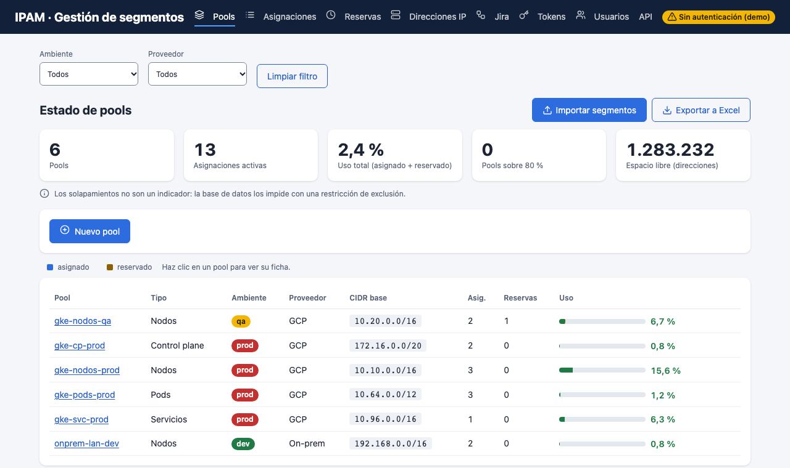

Es la pantalla de inicio.
- **Los cinco números de arriba:** cuántos pools hay, cuántas asignaciones activas, el **uso total**, cuántos pools están **sobre 80 %** y cuántas **direcciones quedan libres**.
- **La barra de uso** de cada pool combina **asignado** (azul) y **reservado** (ámbar). Se pinta **verde** por debajo de 70 %, **ámbar** entre 70 % y 90 % y **roja** por encima de 90 %, con un ícono de alerta: es la señal para pedir un bloque más grande antes de quedarte sin espacio.
- **Filtros:** *Ambiente* (`dev`, `qa`, `pre`, `prod`) y *Proveedor*. Se conservan al cambiar de pestaña; **Limpiar filtro** los quita.
- **Haz clic en el nombre de un pool** para abrir su ficha.

### La ficha de un pool
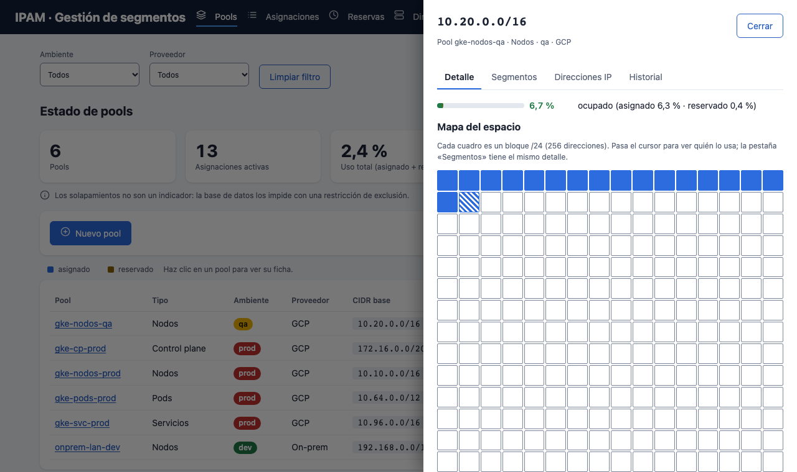

Un panel a la derecha, que se cierra con **Cerrar** o la tecla **Esc**. Tiene cuatro pestañas: **Detalle**, **Segmentos**, **Direcciones IP** e **Historial** (este último, solo para administradores).

En *Detalle* está el **mapa del espacio**: cada cuadro es un bloque `/24` (256 direcciones). Los cuadros **azules** están asignados, los **ámbar** reservados y los **blancos** libres. Pasa el cursor por un cuadro para ver quién lo usa. Es la forma más rápida de ver si el espacio está **fragmentado** o concentrado.

### Segmentos: «todo lo entregado y lo apartado, en una lista»
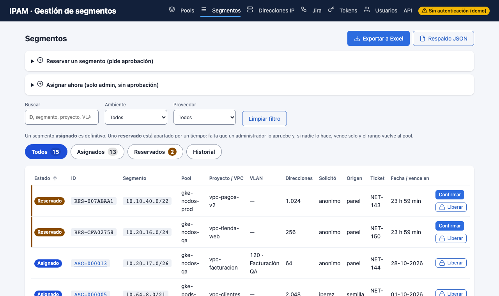

Una sola lista reúne lo que antes estaba en dos pestañas. Cada fila dice su **estado con texto y color** (no solo color):

| Estado | Color | Qué significa |
|---|---|---|
| **Asignado** | azul | Definitivo. Tiene un **ID único** (`ASG-000013`): si el mismo rango se libera y se vuelve a asignar, tendrá otro. |
| **Reservado** | ámbar, con una marca a la izquierda | Apartado por un tiempo, **esperando que un administrador lo apruebe**. Muestra una **cuenta regresiva** (en «Fecha / vence en») y un código `RES-…`. Si nadie lo aprueba, vence solo y el rango vuelve al pool. |
| **Liberada** / **Expirada** | gris / rojo | Reservas que se devolvieron o vencieron sin aprobarse. Solo se ven en *Historial* y no se operan. |

Las reservas **pendientes salen primero**, porque son lo que un administrador tiene que atender; después, lo asignado.

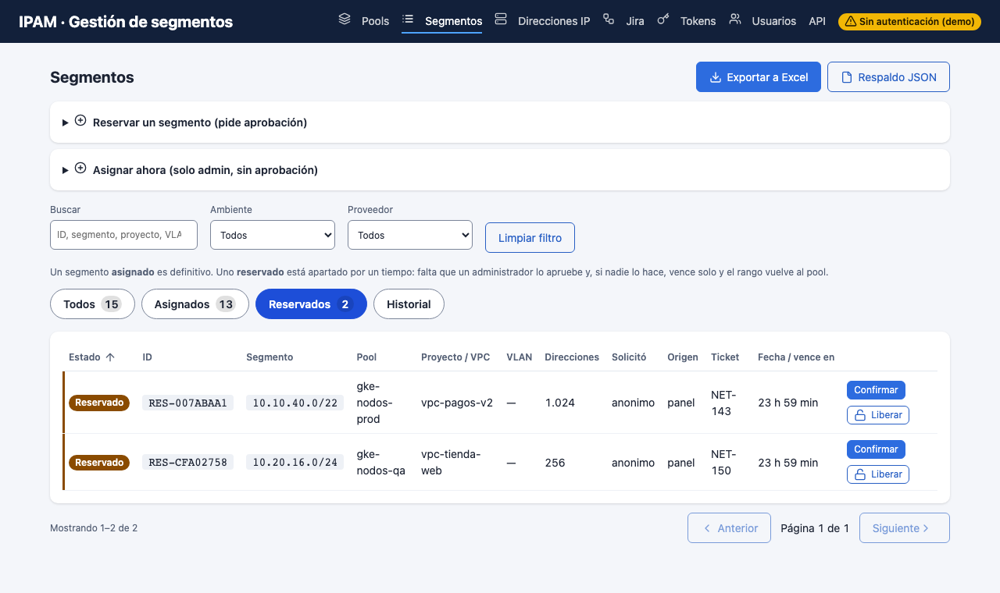

- **Botones de arriba de la tabla:** `Todos · Asignados · Reservados · Historial`. El número de *Reservados* es lo **pendiente de aprobar** (se pinta ámbar cuando hay algo).
- **Qué hace cada fila:** un segmento *reservado* muestra **Confirmar** (aprobarlo: pasa a *Asignado*) y **Liberar** (devolverlo). Uno *asignado* muestra **Liberar** (solo administradores, con doble confirmación).
- **Buscar** por ID, segmento, proyecto, VLAN, ticket, quién lo pidió o su origen; y filtrar por **ambiente** y **proveedor**.
- **Ordenar:** clic en el título de una columna (una flecha indica el sentido). **Paginación:** de 25 en 25.
- Un clic en el **ID** `ASG-…` abre la ficha del segmento. **Exportar a Excel** baja todo.
- Arriba hay dos formularios plegados: **Reservar un segmento** (pide aprobación) y **Asignar ahora** (solo administrador, sin aprobación).

### Direcciones IP: «qué IP tiene cada interfaz»
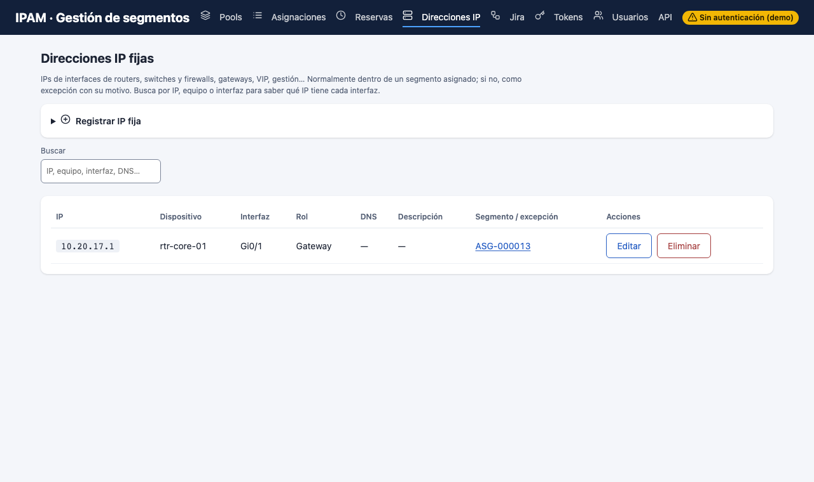

Las IPs fijas de routers, switches, firewalls, gateways y servidores. Escribe el nombre de un equipo en **Buscar** y ves todas sus interfaces con su IP.

### Jira, Tokens y Usuarios
- **Jira** muestra primero el **estado** de la integración (activada o no) y los últimos eventos. Los diagramas de cómo funciona están en «Cómo funciona», plegado.
- **Tokens** (solo administrador): llaves para pipelines y agentes.
- **Usuarios** (solo administrador): quién entra y con qué rol.

## 5. Tareas paso a paso

### Pedir un rango para un proyecto nuevo (solicitante)
1. Ve a **Segmentos** y abre **Reservar un segmento (pide aprobación)**.
2. Elige el **pool**. (Ninguno viene elegido de antemano, y la máscara se habilita al elegirlo.)
3. Escribe el **proyecto / VPC**. Usa minúsculas, números y guiones: `vpc-tienda-web`.
4. Elige la **máscara**. La lista ofrece **solo tamaños que caben** y dice cuántos bloques libres quedan de cada uno (`/24 · 15 libres`). Si no sabes cuál, mira la tabla de disponibilidad que aparece al elegir el pool.
5. Opcional: **VLAN**, **ticket** y cuánto debe durar la reserva (hasta 72 horas).
6. Pulsa **Reservar**. El segmento queda **Reservado** y **un administrador debe aprobarlo**.

> Si escribes un CIDR a mano, el IPAM lo revisa **mientras escribes** y te avisa si está mal escrito, desalineado o fuera del pool, antes de enviar.

### Aprobar una reserva (administrador)
1. Ve a **Segmentos**: las reservas pendientes salen primero y el botón **Reservados** muestra cuántas hay. Púlsalo para ver solo esas.
2. Revisa el segmento, el proyecto y quién la pidió. Las que vienen de **Jira** solo las puede aprobar un administrador: confirmar es dar la **aprobación manual**.
3. Pulsa **Confirmar**. La fila pasa a **Asignado** y recibe su ID `ASG-…`.
4. Si no corresponde, pulsa **Liberar**. Si nadie hace nada, expira sola.

### Entregar un rango ahora mismo (administrador)
Úsalo solo cuando no necesitas el flujo de aprobación; queda en el historial a tu nombre.

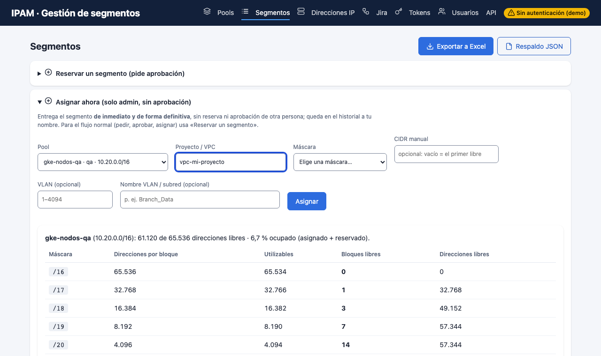

1. **Segmentos** → **Asignar ahora (solo admin, sin aprobación)**.
2. Elige el **pool**: aparece la tabla de **disponibilidad por máscara**, con los bloques libres de cada tamaño. Un clic en una fila elige esa máscara.
3. Escribe el **proyecto / VPC**, la **máscara** (o un **CIDR manual**) y, si quieres, la **VLAN** y su nombre.
4. Pulsa **Asignar**.
5. Si el rango choca con otro, el IPAM **no asigna nada**: te muestra con quién choca y ofrece **segmentos libres** con un botón *Usar*.

### Saber cuánto espacio queda
- **Rápido:** pestaña **Pools** → barra de uso y el número de *Espacio libre*.
- **Detallado:** clic en el pool → *Detalle*: **bloque libre más grande** y mapa del espacio.
- **Por tamaño:** al elegir un pool en cualquier formulario, la tabla muestra cuántos bloques libres hay de cada máscara.

### Registrar la IP de un equipo
1. Abre la pestaña **Direcciones IP** → **Registrar IP fija** (o hazlo desde la ficha del segmento).
2. Escribe la **IP**: el IPAM la ubica solo en su segmento. Completa **dispositivo** (`rtr-core-01`), **interfaz** (`Gi0/1`) y **rol** (gateway, gestión…).
3. Si la IP no cae en ningún segmento (por ejemplo, la IP pública de un firewall), escribe el **motivo de la excepción**; quedará marcada como tal.
4. Para encontrarla después, escribe el equipo, la IP o la interfaz en **Buscar**.

### Devolver un rango que ya no se usa (administrador)
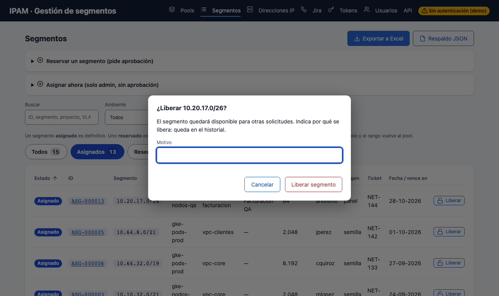

1. **Segmentos** → **Liberar** en la fila de un segmento *Asignado*. Hazlo solo cuando la red realmente se eliminó.
2. Escribe el **motivo** (es obligatorio y queda en el historial) y confirma con **Liberar segmento**. **Esc** cancela.
3. Aparece una **segunda confirmación**, «Última confirmación»: hay que **escribir el CIDR exacto** del segmento (por ejemplo `10.64.8.0/21`) y pulsar **Sí, liberar ahora**. Si el texto no coincide, no avanza. Existe para que no se libere por error un bloque que sigue en uso; **Cancelar** o **Esc** en cualquier paso lo deja todo como estaba.
4. No se puede liberar un segmento que aún tiene IPs registradas: elimínalas primero.

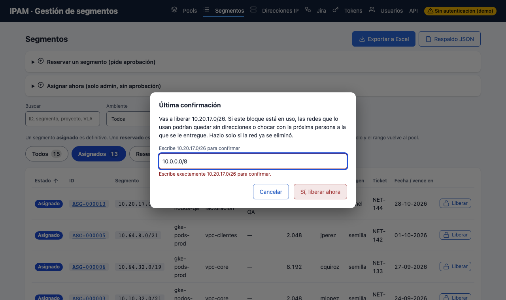

### Cargar el inventario que ya existe (administrador)
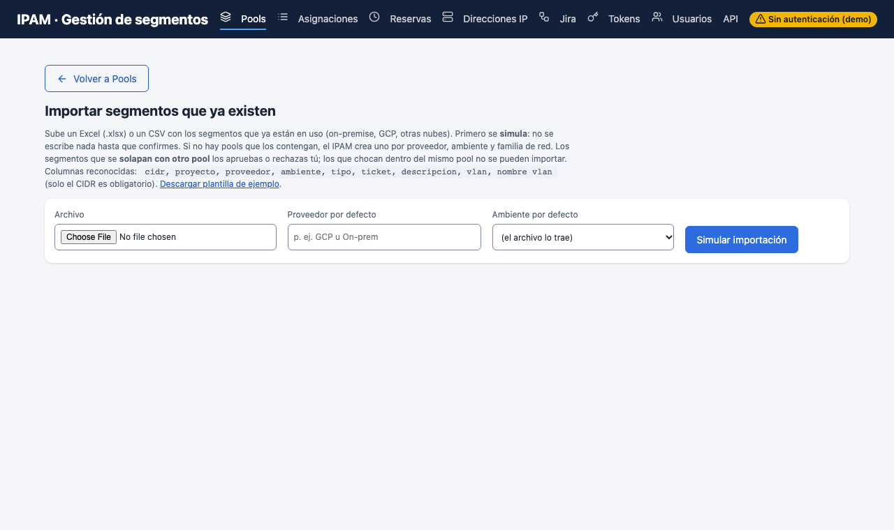

1. **Pools** → **Importar segmentos**. Descarga la **plantilla de ejemplo**.
2. Completa tu Excel o CSV: solo la columna **cidr** es obligatoria; puedes agregar proyecto, proveedor, ambiente, tipo, ticket y VLAN.
3. Pulsa **Simular importación**: **no se escribe nada todavía**. Cada fila queda como *Listo para importar*, *Ya registrado* (se omite), *Solapa con otro pool* (necesita tu visto bueno), *Choca dentro del mismo pool* o *Inválida*.
4. Corrige lo que haga falta y pulsa **Importar**. Es **todo o nada**: si algo falla, no se importa ninguno.

### Crear un pool nuevo (administrador)
1. **Pools** → **Nuevo pool**.
2. Escribe el **nombre** (minúsculas, números y guiones), el **tipo** (Nodos, Pods, Servicios…), el **ambiente**, el **proveedor** y el **CIDR** del bloque.
3. No puede solaparse con otro pool del **mismo proveedor y ambiente**. Para cambiar el tipo o el proveedor, o eliminar un pool vacío, abre su ficha → *Editar o eliminar este pool*.

### Crear una llave para un pipeline (administrador)
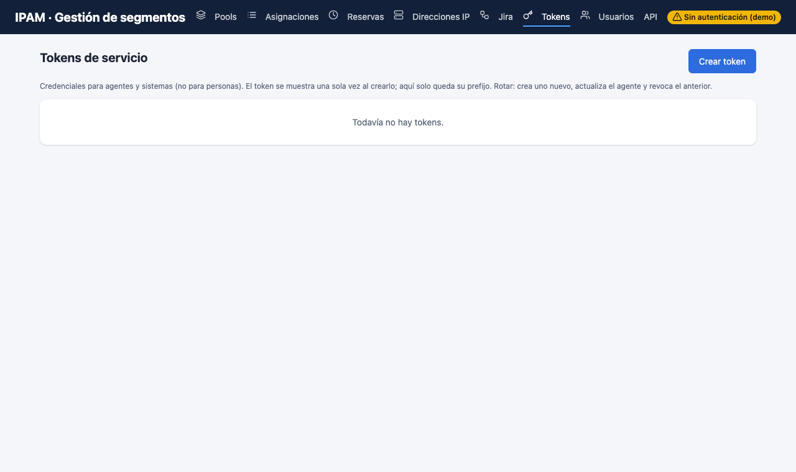

1. **Tokens** → **Crear token**: nombre, rol (`agente` o `lector`), vencimiento y, si quieres, un tope de reservas vigentes.
2. El token **se muestra una sola vez**: cópialo con el botón **Copiar** y guárdalo en el gestor de secretos del pipeline. Si lo pierdes, crea otro y revoca el anterior.
3. **Revocar** lo deja inservible al instante. Buenas prácticas: un token por agente, con vencimiento corto.

### Dar de alta a una persona (administrador)
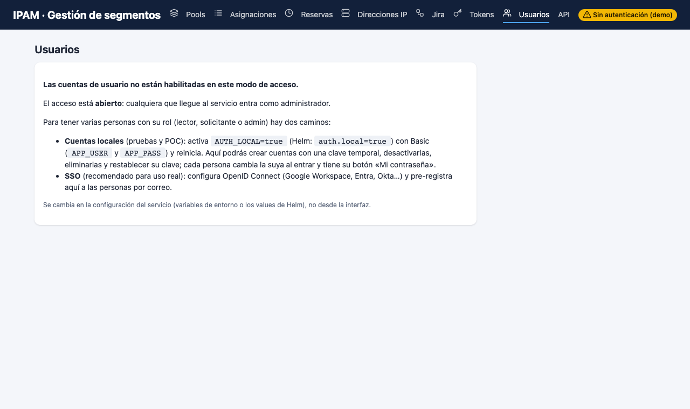

- **Con SSO:** *Pre-registrar* a la persona por correo, con su rol. Puedes cambiarle el rol, **desactivarla** (conserva su historial) o eliminarla.
- **Con cuentas locales:** *Nueva cuenta local* → se muestra una **clave temporal una sola vez**; entrégala por un canal seguro. La persona deberá cambiarla al entrar.
- Nadie puede desactivarse ni eliminarse a sí mismo.

### Sacar un informe
**Exportar a Excel** (en Pools o en Segmentos) baja una planilla con los segmentos, sus IDs, VLAN e IPs fijas. Un administrador también puede bajar el **Respaldo JSON** completo.

## 6. Si algo no sale como esperabas

| Veo… | Significa | Qué hacer |
|---|---|---|
| «Solapamiento detectado» | El rango pedido choca con otro | Usa uno de los segmentos libres que sugiere |
| «Fuera del pool» | El CIDR no cae dentro del pool elegido | Revisa pool y rango, o deja el CIDR vacío |
| Un campo con borde rojo y un mensaje | El valor que escribiste no es válido | Lee el mensaje debajo del campo y corrígelo |
| Máscara en gris, «sin espacio» | Ya no quedan bloques de ese tamaño | Elige una máscara más pequeña u otro pool |
| «Tu cuenta no tiene un rol asignado» | Entraste, pero nadie te dio permisos | Pide el rol a un administrador |
| Pantalla «Entrar» otra vez | Tu sesión venció o se cerró | Vuelve a entrar con tu cuenta |
| Error 403 | Tu rol no alcanza para esa acción | Pide el rol, o que un administrador la haga |
| Error 409 en una reserva | Ya fue liberada o expiró | Crea una reserva nueva |
| Error 429 | Demasiadas peticiones o demasiadas reservas vigentes | Espera un minuto o libera reservas que no uses |
| La primera carga tarda más de un minuto | El entorno de pruebas gratuito estaba «dormido» | Espera y recarga |

Si el problema sigue, anota **la hora**, lo que hacías y el mensaje, y avisa a tu administrador: con eso puede encontrarlo en los registros.

## 7. Preguntas frecuentes

**¿Por qué mi reserva «desapareció»?** Expiró: nadie la aprobó dentro de su plazo (24 horas por defecto). El rango volvió al pool. Crea otra.

**¿Puedo cambiar el CIDR de una asignación?** No. Libera la anterior (si ya no se usa) y pide una nueva. Así el historial es fiel.

**¿Puedo reservar un rango que ya está asignado en otro ambiente?** Los pools son por **ambiente y proveedor**: el mismo rango puede existir en `dev` y en `qa` de redes distintas. Dentro de uno mismo, el IPAM **nunca** deja que dos segmentos se solapen.

**¿Quién puede ver el historial de un segmento?** Los administradores, en la pestaña *Historial* de la ficha. Registra quién asignó, reservó, aprobó o liberó, y cuándo.

**¿Se puede borrar el historial?** No. La bitácora es de solo inserción, a propósito: sirve como evidencia.

**¿Funciona en el celular?** Sí; las tablas se desplazan hacia el lado y los indicadores se acomodan en dos columnas. También hay modo oscuro, que sigue la configuración de tu equipo.

**¿Puedo usarlo con el teclado?** Sí: **Tab** navega, **Enter** abre, **Esc** cierra los paneles y diálogos, y al abrir un diálogo el foco queda dentro de él.

## 8. Lo que el IPAM no hace
- **No crea las redes** en la nube ni en el equipamiento: solo lleva la cuenta de quién tiene qué rango.
- **No descubre solo lo que ya existe**: hay que cargarlo (importación) o registrarlo.
- **No verifica por sí mismo quién aprobó** una reserva que viene de un pipeline: se apoya en la persona que la confirma.

Más detalle en [Limitaciones](LIMITACIONES.md).
