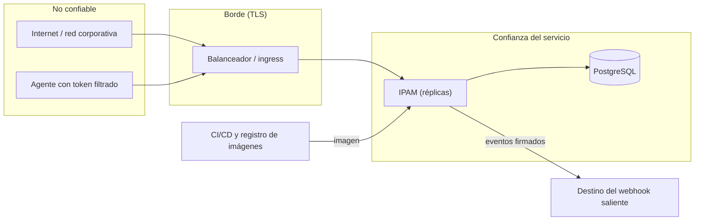

# Modelo de amenazas del IPAM (una página)

Preguntas que responde: **¿qué protegemos, de quién, cómo y qué sigue siendo un riesgo?** Referencias: OWASP ASVS nivel 2 y OWASP API Security Top 10.

## Qué protegemos (en orden de importancia)
1. **Que nunca se asigne dos veces el mismo rango.** Un solape rompe redes en producción.
2. **Las credenciales:** tokens de servicio, sesiones, contraseñas y la cadena de conexión a la base.
3. **La bitácora de auditoría:** quién hizo qué. Si se puede alterar, no sirve.
4. **Disponibilidad:** que los agentes puedan reservar cuando lo necesitan.

## Quién puede atacar y desde dónde

## Amenazas y defensas
| # | Amenaza | Defensa en el IPAM | Se verifica con | Riesgo que queda |
|---|---|---|---|---|
| 1 | Dos reservas o asignaciones se solapan (carreras, varias réplicas) | Bloqueo por pool y por solicitante; restricción de exclusión GiST y disparadores en la base; el reloj es el de la base | pruebas de concurrencia con 2 instancias; prueba de propiedades (secuencias aleatorias) | Un administrador de la base puede deshabilitar disparadores |
| 2 | Token robado | 256 bits aleatorios, solo el hash en la base, vencimiento (≤ 365 días), revocación inmediata, rol mínimo, **alcance** por grupos de la API (`403 fuera_de_alcance`), **cuota** de reservas, límite de peticiones, auditoría `svc:<nombre>` | pruebas de tokens, alcance, cuota y rate limit | Un token válido robado sirve hasta que se revoque (ver runbook) |
| 3 | Fuerza bruta de credenciales | Freno por IP a los intentos fallidos (429), comparaciones en tiempo constante, contraseña Basic con hash scrypt | pruebas de fuerza bruta y de contraseñas | Detrás de un NAT compartido se bloquea a todos los de esa IP |
| 4 | Un agente confirma sin que nadie lo apruebe | **Confirmar es solo de admin**: un token de servicio recibe 403 aunque declare `aprobado_por`; una reserva sin confirmar expira sola; la aprobación queda auditada con la cuenta del admin | `matriz-roles.test.js`, pruebas de tokens y de expiración | Un admin puede aprobar sin criterio (es su rol); la credencial del agente no puede |
| 5 | Inyección SQL | Solo consultas parametrizadas; una regla de lint falla si se arma SQL con texto; roles de base de datos de permisos mínimos | `calidad.test.js` (la regla falla ante concatenación), pruebas de roles | — |
| 6 | XSS / robo de sesión por la interfaz | CSP estricta sin scripts en línea; la interfaz construye el DOM con nodos de texto o escapa; cookies HttpOnly, SameSite y Secure; CSRF con cabecera obligatoria para cookie/Basic | pruebas e2e de XSS en todas las pestañas; pruebas de cabeceras y cookies | Los estilos en línea siguen permitidos (limitación heredada) |
| 7 | SSRF por el webhook saliente | Bloqueo de destinos privados, loopback, enlace local y metadatos de nube; sin seguir redirecciones; resolución DNS validada al conectar; lista permitida explícita; firma HMAC; reintentos acotados | pruebas de SSRF y del webhook | La lista de hosts permitidos la define quien opera |
| 8 | Alterar o borrar la auditoría | Tabla de solo inserción (disparador, también para el dueño) y el rol de la app sin UPDATE/DELETE | pruebas de roles y del disparador | Un superusuario de la base puede deshabilitar el disparador |
| 9 | Filtración de secretos | Secretos solo en variables de entorno o archivos (`_FILE`); redacción automática en logs y errores; el token se muestra una vez; gitleaks en CI y pre-commit | pruebas de logs y métricas sin secretos; gitleaks | Un secreto mal guardado por quien despliega |
| 10 | Despliegue abierto por olvido | En producción sin autenticación el servicio **no arranca**; Helm falla sin auth | pruebas de arranque seguro y de Helm | `ALLOW_ANONYMOUS=true` (solo demos) sí abre todo |
| 11 | Dependencias o imagen vulnerables / manipuladas | `npm ci` con lockfile, `npm audit`, SBOM CycloneDX, licencias, imagen base por digest, Trivy/Semgrep/Checkov, acciones de CI fijadas por commit; firma opcional (cosign) | escaneos en CI | `exceljs` arrastra un `uuid` con aviso moderado (no explotable en nuestro uso); firma de imágenes desactivada por defecto |
| 12 | Denegación de servicio | Límite por actor e IP, tamaño máximo de cuerpo, timeouts en la base y salientes, `statement_timeout`, apagado ordenado | pruebas de límites y de apagado | Un volumen alto de peticiones válidas desde muchas IP |
| 13 | Una cuenta o un token hace más de lo que su rol permite | Cada ruta de `/api/v1` declara su rol mínimo; los agentes no pueden liberar una asignación definitiva; `/eventos` (trae errores de Jira y solicitantes) es solo para admin; sesiones OIDC revalidadas en la base cada 5 min; `MODULOS_DESACTIVADOS` apaga lo que no se usa | `matriz-roles.test.js` (un token de rol menor recibe 403 en cada ruta; una ruta sin rol declarado rompe la prueba) | Una baja o un cambio de rol tarda hasta `SESSION_REVALIDAR_SEG` en regir en las demás réplicas |
| 14 | Webhook de Jira falsificado o repetido | Firma HMAC sobre `<timestamp>.<cuerpo>`, ventana de ±5 min, idempotente por ticket; el webhook solo crea una reserva (la aprueba un admin) | `firma-webhook.test.js` | Un reenvío dentro de la ventana es inofensivo pero llega |
| 15 | IP del cliente falsa (límite por IP y auditoría) | `TRUST_PROXY` con los saltos reales (3 en el POC); un `X-Forwarded-For` falso no cambia la IP vista | pruebas de cabeceras; verificado en el POC | Un valor de `TRUST_PROXY` equivocado vuelve global el límite por IP |
| 16 | Tráfico interceptado | TLS hasta el borde; `DATABASE_SSL=verify-full` posible | — | **TLS interno (ingress → app) y modo `require` sin verificación son deuda conocida** ([`LIMITACIONES.md`](LIMITACIONES.md)) |

## Qué NO cubre este modelo
Compromiso del clúster o de la cuenta de nube, administradores maliciosos de la base de datos, y seguridad del proveedor de identidad (Google Workspace, Entra…).
