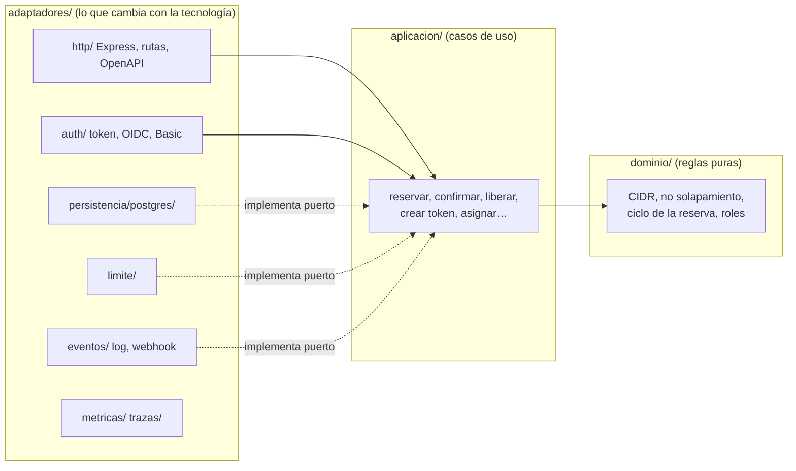

# ADR 0000 · Arquitectura desacoplada (hexagonal + doce factores)

- **Estado:** aceptada · **Fecha:** 2026-10-21
- **Decide:** equipo de plataforma (EstratoTech) · **Afecta a:** todo el código de `mvp/src/`

## Contexto
El IPAM nació como un servidor Express de un solo archivo que mezclaba reglas de negocio, SQL y HTTP. Eso funcionó para la demo, pero ahora
tiene que cumplir tres cosas a la vez:

1. correr igual en Render + Supabase (POC), Google Cloud, AWS, Azure o un servidor propio;
2. ser el «libro de direcciones» al que consultan agentes automáticos (redes, DevOps…) por API;
3. poder revisarse y probarse con seriedad (seguridad y calidad verificables).

## Decisión
**1. Arquitectura hexagonal («puertos y adaptadores»).** El código se organiza en tres anillos y las dependencias solo apuntan hacia adentro:

- `dominio/`: reglas puras. Sin Express, sin SQL, sin red, ni siquiera módulos del sistema.
- `aplicacion/`: casos de uso. Hablan con el mundo a través de **puertos** (interfaces): repositorio, publicador de eventos, auditor, reloj, almacén de límites.
- `adaptadores/`: implementan los puertos y conectan con la tecnología (Express, PostgreSQL, OIDC…).
- `server.js` es la «raíz de composición»: el único lugar donde se conectan las piezas.

**2. Doce factores («12-factor»).** Una sola imagen para todos los ambientes; configuración solo por variables de entorno (módulo `config`,
con forma `NOMBRE_FILE` para secretos montados); sin estado local (varias réplicas); logs JSON a stdout; procesos desechables
(apagado ordenado con SIGTERM); migraciones como paso aparte (`npm run migrar`).

**3. Microservicio con contrato primero.** API versionada (`/api/v1`) descrita en OpenAPI 3.1, sondas `/healthz` y `/readyz`,
correlación con `X-Request-Id`, métricas Prometheus y trazas OpenTelemetry. Los demás agentes **solo usan la API**: nadie lee ni escribe las tablas del IPAM.

## Cómo se hace cumplir (no es solo una declaración)
- `scripts/verificar-portabilidad.sh` falla si `dominio/` o `aplicacion/` importan infraestructura, si aparece un SDK de proveedor
  o si se lee `process.env` fuera de `config.js`. Corre en CI y en el hook de pre-commit.
- `src/arquitectura.test.js` repite esas reglas como prueba automática (incluida la prueba de que la guardia **sí falla** ante una violación).
- La prueba de `servicio.test.js` comprueba el comportamiento de proceso desechable: SIGTERM, sondas, esquema fuera del arranque, varias réplicas.

## Consecuencias
- (+) Se puede cambiar PostgreSQL por otro almacén, o Express por otro servidor, tocando solo adaptadores.
- (+) Los casos de uso se prueban sin base de datos (repositorio en memoria) y con propiedades.
- (−) Más archivos y más «pegamento» que el servidor único de antes. Se acepta a cambio de poder revisar cada pieza por separado.
- (−) Los nombres antiguos (`src/auth.js`, `src/cidr.js`, `src/marca.js`) quedan como alias finos para no romper pruebas ni scripts existentes.

## Alternativas descartadas
- **Reescritura completa:** riesgo alto; se refactorizó de forma incremental, con las pruebas existentes en verde en cada paso.
- **Dejarlo en capas «clásicas» (rutas → servicios → SQL):** no impide que la lógica de negocio dependa de Express o de `pg`.
