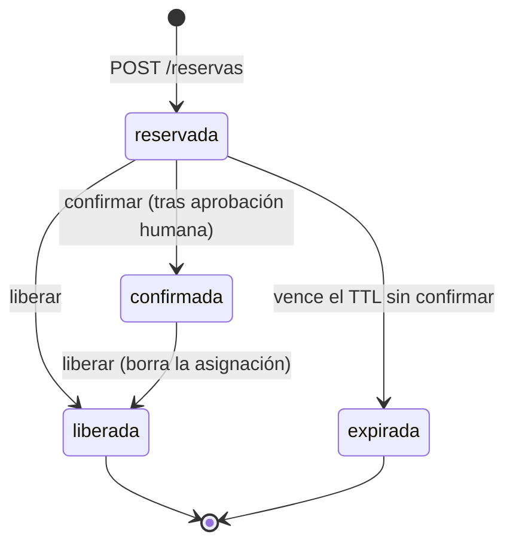

# ADR 0001 · Reservas tentativas (opción B)

- **Estado:** aceptada · **Fecha:** 2026-10-21 · **Lineamiento del cliente:** human-in-the-loop (reunión Co-workers, 21-oct-2026)

## Contexto
El agente de redes necesita **saber qué rangos IP le tocan antes** de escribirlos en el código de infraestructura (variables de OpenTofu en un merge request).
Pero ese cambio todavía lo tiene que **aprobar una persona**. Si el IPAM asignara de forma definitiva al pedirlo, un MR rechazado o un pipeline roto dejaría rangos
«quemados» para siempre, y alguien tendría que acordarse de devolverlos.

## Opciones consideradas
| Opción | Cómo funciona | Problema |
|---|---|---|
| **A. Asignar directo y borrar si falla** | El agente pide una asignación y, si algo sale mal, la libera | Si el agente muere o el pipeline se rechaza sin avisar, el rango queda ocupado. Una asignación «definitiva» que nadie aprobó rompe la regla del cliente |
| **B. Reserva tentativa que expira sola** *(elegida)* | El agente reserva; la reserva aparta el rango un tiempo (TTL); solo se vuelve asignación si se **confirma** | Un estado más que explicar |
| **C. No reservar; asignar recién en el `apply`** | El agente no sabe su rango hasta el final | No puede escribir el rango en el MR que la persona está revisando |

## Decisión
**Opción B.** Una reserva pasa por estos estados:

Reglas que se mantienen:
1. **Ninguna reserva se vuelve asignación definitiva sin confirmación explícita.** Y un token de servicio debe declarar `aprobado_por` y `referencia` (p. ej. el MR aprobado) para confirmar;
   queda en la auditoría. (El IPAM no puede *verificar* que esa persona aprobó: la garantía real es el paso manual protegido del pipeline. Ver `docs/ops/gitlab/`.)
2. **Una reserva sin confirmar expira sola** (24 h por defecto, máximo 72; ver [0003](0003-ttl-24-horas.md)).
3. **Los rangos ocupados son asignaciones + reservas vigentes**, con las mismas garantías de no solape (bloqueo por pool y restricción de exclusión en la base).
4. **Idempotencia:** misma clave y reserva viva → se devuelve la misma (`repetida: true`); misma clave con reserva liberada o expirada → 409 (no se «resucita»).
5. Solo el dueño o un admin opera sobre una reserva.

## Consecuencias
- (+) Un MR rechazado o abandonado no deja basura: la reserva expira sola o se libera con `liberar-ipam`.
- (+) El agente reintenta sin miedo (idempotencia) y el pipeline puede reservar al principio y confirmar al final.
- (−) Más estados y más casos borde (expiración mientras se revisa el MR): por eso hay TTL máximo y mensajes claros (`reserva_no_vigente`).
- (−) Si el MR tarda más que el TTL, hay que volver a reservar.
