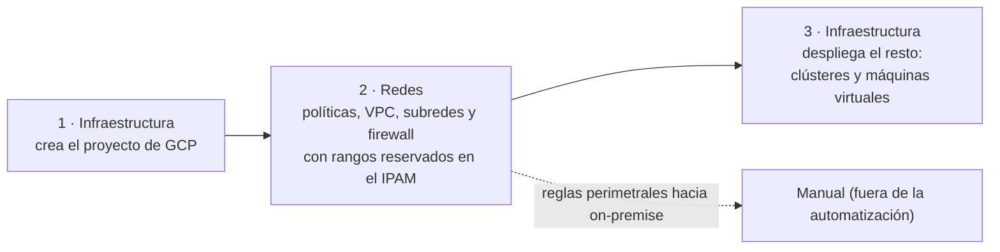
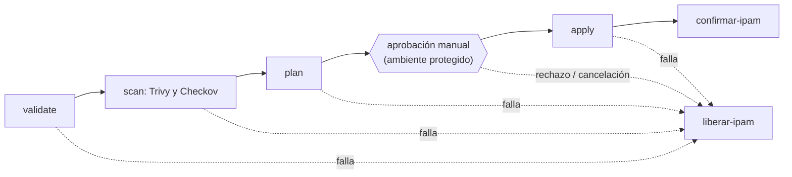

# Pipeline de ejemplo para el repositorio de infraestructura de redes (GitLab + OpenTofu)

> **No se ejecutó contra un GitLab ni una cuenta de GCP reales.** Su sintaxis y su esquema se validaron con `gitlab-ci-local`; el bloque HCL con `tofu validate` y `tofu fmt`.
> Es un punto de partida para que el equipo lo adapte. Todos los nombres, URLs y rangos son de relleno.

Archivos: [`.gitlab-ci.yml`](.gitlab-ci.yml) (el pipeline) y [`ejemplo-hcl/redes-criticas.tf`](ejemplo-hcl/redes-criticas.tf) (redes críticas protegidas).

## Orden de ejecución entre equipos (lineamiento del cliente)

La automatización cubre **solo GCP**. Las reglas perimetrales hacia on-premise son **manuales** (ver [`../../LIMITACIONES.md`](../../LIMITACIONES.md)).

## Etapas del pipeline

| Etapa | Qué hace |
|---|---|
| `validate` | `tofu fmt -check` y `tofu validate` |
| `scan` | Trivy (configuración) y Checkov; en la reunión se mencionó una tercera herramienta llamada «Whisky»: **nombre por confirmar** (parece un error de transcripción); cuando se sepa cuál es, se agrega como otro trabajo |
| `plan` | Genera el plan y lo guarda como artefacto |
| `aprobacion-manual` | **Una persona** lo ejecuta en un ambiente protegido (`allow_failure: false`: sin esto no avanza) |
| `apply` | Aplica el plan aprobado |
| `confirmar-ipam` | Confirma las reservas en el IPAM con `aprobado_por` (quien ejecutó el paso manual) y `referencia` (la URL del pipeline); recién ahí son asignaciones definitivas |
| `liberar-ipam` | Si algo falla o se rechaza, libera las reservas. Si nadie hace nada, **expiran solas** (24 h por defecto, máximo 72) |

## Reglas importantes
- **Human-in-the-loop:** ninguna reserva se vuelve asignación definitiva sin aprobación humana. El IPAM no puede *verificar* quién aprobó: la garantía real es el **ambiente protegido** del paso manual; por eso solo los aprobadores definidos deben poder ejecutarlo.
- **`tofu` o `terraform`:** los ejemplos usan `tofu`; `terraform` es compatible (cambia la imagen y `TF_BIN`).
- **Ramas:** flujo `feature` → `master` con MR (la rama por defecto sale de `$CI_DEFAULT_BRANCH`, no está escrita a fuego).
- **Redes críticas:** las VPC y subredes de producción llevan `lifecycle { prevent_destroy = true }` (ejemplo validado en `ejemplo-hcl/`).
- **Sin llaves de larga duración:** el pipeline se identifica ante GCP con su token OIDC (`id_tokens`) mediante federación de identidad de carga de trabajo (ver [`../MIGRAR-A-GITLAB.md`](../MIGRAR-A-GITLAB.md)).
- **Primera llamada al IPAM:** si el servicio estaba dormido (POC en plan gratuito) puede tardar; el pipeline llama a `/healthz` con reintentos y usa un tiempo de espera de 120 s.
- **`ipam-reservas.json`:** lo escribe el agente de redes en el MR con los `id` de las reservas (formato `[{"id": "uuid", "cidr": "10.230.0.0/24"}]`); es lo que confirma o libera el pipeline.
- **Imágenes en producción:** conviene fijarlas por digest (como en el pipeline del IPAM).
