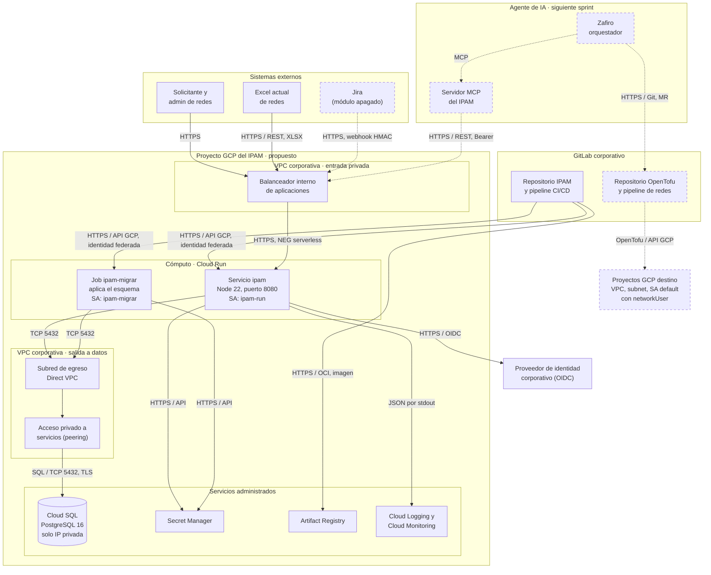
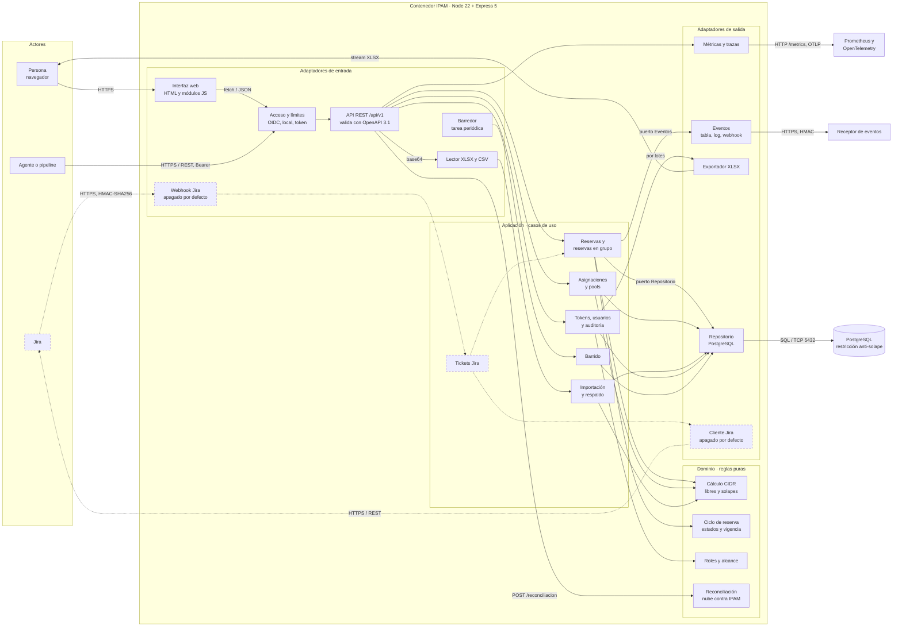
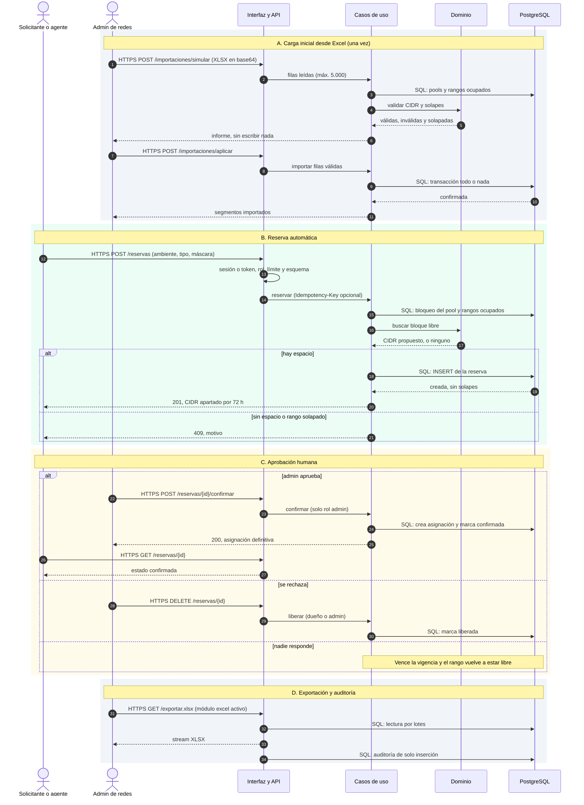

# IPAM: diagramas de arquitectura

Documento para el equipo de arquitectura, redes y plataforma. Describe el IPAM versión `0.6.0` y la arquitectura propuesta para llevarlo a Google Cloud (GCP).

**Cómo leerlo**

| Marca | Significado |
|---|---|
| Línea continua | Existe en el código, o es parte del despliegue propuesto para el primer paso a GCP |
| Línea punteada, borde punteado | Planificado para el siguiente sprint (agente de IA), o apagado por defecto (Jira) |

El IPAM corre hoy solo en un equipo local. **El diagrama 1 es una propuesta**: nada de él está desplegado todavía.

## 1. Despliegue y arquitectura en GCP (propuesta)

**Decisiones de diseño**

1. **Cloud Run antes que GKE.** Es un solo contenedor sin estado y con poca carga. Un clúster agrega operación sin aportar nada a este volumen.
2. **Sin entrada desde Internet.** El ingreso de Cloud Run acepta solo tráfico interno y del balanceador.
3. **Dos identidades.** La que atiende peticiones no puede cambiar el esquema. La que migra no atiende peticiones.
4. **Base solo con IP privada, por TCP 5432.** La documentación de Google describe la conexión por IP privada como TCP directo; el socket `/cloudsql` aparece bajo la ruta de IP pública. El ejemplo OpenTofu del repositorio usa el socket con una base solo privada, por lo que **hay que probarlo o cambiarlo antes de desplegar**.
5. **Sin llaves de larga duración.** GitLab se autentica en GCP con Workload Identity Federation.
6. **Sin Firestore, Cloud Storage ni Cloud Scheduler.** El Excel se procesa en memoria y la limpieza de reservas vencidas corre dentro del servicio. Si se guardan respaldos lógicos fuera de Cloud SQL, ahí sí se suma un bucket.

Se distingue el **acceso al IPAM** (arriba) del **pipeline de infraestructura**: el IPAM nunca crea redes. Solo aparta y registra rangos; OpenTofu crea la VPC y la subnet en los proyectos destino.

## 2. Contenedores y componentes (C4, niveles 2 y 3)

La arquitectura es **hexagonal**: el dominio no conoce la base de datos ni la red. Las flechas simplifican las dependencias; los casos de uso llegan a los adaptadores de salida por puertos, y `server.js` los conecta al arrancar. Una prueba automática impide que el núcleo importe el SDK de una nube.

## 3. Secuencia de extremo a extremo

El disparador es HTTP: una persona en la interfaz, o un agente por la API. No hay Cloud Scheduler.

Todas las rutas cuelgan de `/api/v1`. Para una **VPC nueva** el flujo B y C se recorre dos veces: primero el bloque de la VPC y, una vez aprobado, sus subnets (`POST /reservas/lote`).

## 4. Componentes identificados

| Componente | Tecnología / servicio GCP | Responsabilidad | Estado |
|---|---|---|---|
| Servicio IPAM | Cloud Run, Node 22, Express 5 | Interfaz, API y reglas | Código listo, despliegue por hacer |
| Migrador | Cloud Run Job | Aplica el esquema antes de cada versión | Código listo, despliegue por hacer |
| Base de datos | Cloud SQL, PostgreSQL 16 | Datos, anti-solape y auditoría | Propuesto |
| Secretos | Secret Manager | Conexión, sesión, OIDC y métricas | Propuesto |
| Identidades | Cloud IAM (2 cuentas de servicio) | Mínimo privilegio | Propuesto |
| Imagen | Artifact Registry | Guarda la imagen versionada | Propuesto |
| Entrada | Balanceador interno de aplicaciones | Acceso privado a la interfaz y API | Propuesto, no está en el ejemplo OpenTofu |
| Red | Direct VPC egress y acceso privado a servicios | Camino privado a la base | Propuesto |
| Observabilidad | Cloud Logging y Cloud Monitoring | Logs, tablero y alertas | Logs listos; métricas requieren recolector |
| CI/CD | GitLab y Workload Identity Federation | Pruebas, imagen y despliegue | `.gitlab-ci.yml` existe, sin ejecutar en GitLab real |
| Identidad de personas | OIDC corporativo | Inicio de sesión y roles | Código existe, **botón apagado** |
| Servidor MCP del IPAM | Por definir | Expone la API como herramientas del agente | **No existe, siguiente sprint** |
| Agente de IA y Zafiro | Desarrollo interno | Orquesta la solicitud y prepara el MR | **Siguiente sprint** |
| Infraestructura destino | OpenTofu, VPC, subnet, IAM | Crea la red con el CIDR aprobado | **Siguiente sprint** |

## 5. Supuestos y dependencias por confirmar

### Bloqueantes antes de desplegar

Se encontraron al revisar el código. No se modificó nada.

| # | Hallazgo | Evidencia | Acción |
|---|---|---|---|
| 1 | **Acceso `admin`/`admin`** si falta `APP_PASS`, también en producción con OIDC. Se probó en local: respondió 200 con sesión | `mvp/src/adaptadores/auth/emergencia.js` | Quitar la clave por defecto y fallar al arrancar |
| 2 | **Clave fija para firmar sesiones** si falta `SESSION_SECRET`. Solo OIDC la exige, y los ejemplos de Cloud Run no la definen | `mvp/src/adaptadores/auth/sesion.js` | Exigirla siempre en producción |
| 3 | **SSO oculto:** `/auth/opciones` responde siempre `sso: false` | `mvp/src/adaptadores/auth/emergencia.js` | Reactivar con el OIDC corporativo |
| 4 | **El pipeline de ejemplo fallaría:** su paso `confirmar-ipam` usa token de agente, pero confirmar exige rol admin (403). Además va después de `apply` | `docs/ops/gitlab/.gitlab-ci.yml` | Reemplazar por esperar la aprobación antes de `apply` |
| 5 | **Socket de Cloud SQL con base solo privada**, sin probar | `despliegue/ejemplos-iac/gcp/main.tf` | Usar TCP a la IP privada |

### Por confirmar

| # | Supuesto | Quién confirma |
|---|---|---|
| 1 | Proyecto GCP, región y VPC donde vivirá el IPAM | Plataforma y redes |
| 2 | Si se usa Shared VPC. De ello depende `roles/compute.networkUser` en la subnet | Redes |
| 3 | **Qué cuenta es la «SA default»:** la de Compute Engine o la de APIs de Google (`NUMERO@cloudservices.gserviceaccount.com`) | Redes y seguridad |
| 4 | Que el rol se otorgue por subnet y no a todo el proyecto host. Lo otorga un administrador de Shared VPC | Seguridad |
| 5 | Proveedor OIDC corporativo y grupos para cada rol | Seguridad |
| 6 | Conectividad desde GitLab, Zafiro y usuarios hasta el balanceador interno, con DNS y certificado | Redes |
| 7 | Calidad del Excel actual: duplicados, solapes y dueños vigentes | Redes |
| 8 | Rangos base y tamaños por ambiente. El IPAM no permite repetir un rango entre pools independientes | Redes |
| 9 | Si Jira se reactiva. La salida hacia Jira no se ha probado con un Jira real | Dueño de Jira |
| 10 | Contrato del servidor MCP, identidad del agente y custodia de su token | Equipo del agente |
| 11 | Respaldo, retención y tiempos de recuperación de Cloud SQL | Plataforma |
| 12 | Doble aprobación: en el IPAM (el rango) y en el MR (el cambio) | Redes y arquitectura |

**Fuera de alcance del IPAM:** IPv6, descubrimiento automático de redes existentes, reglas hacia on-premise y firewalls.

**Referencias:** [Cloud Run con Cloud SQL](https://docs.cloud.google.com/sql/docs/postgres/connect-run), [Shared VPC](https://docs.cloud.google.com/vpc/docs/provisioning-shared-vpc), [balanceador interno con Cloud Run](https://docs.cloud.google.com/load-balancing/docs/l7-internal/setting-up-l7-internal-serverless), [rangos internos de GCP](https://docs.cloud.google.com/vpc/docs/internal-ranges).
